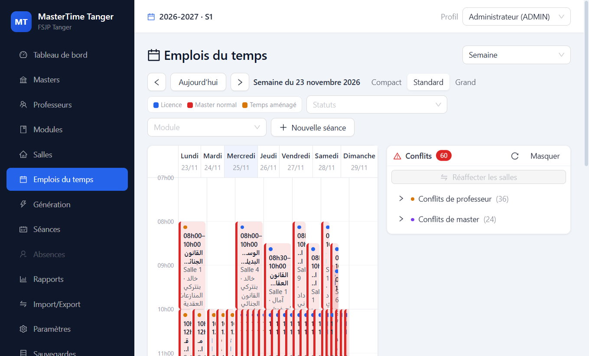
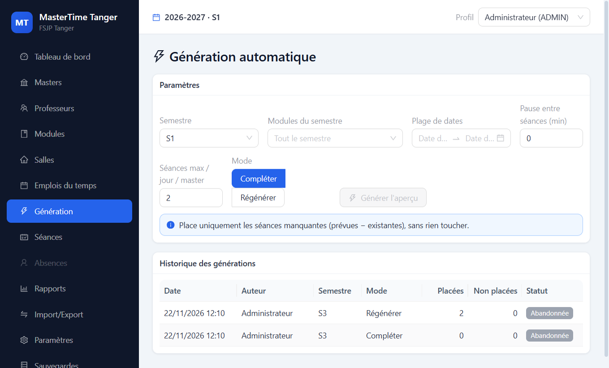
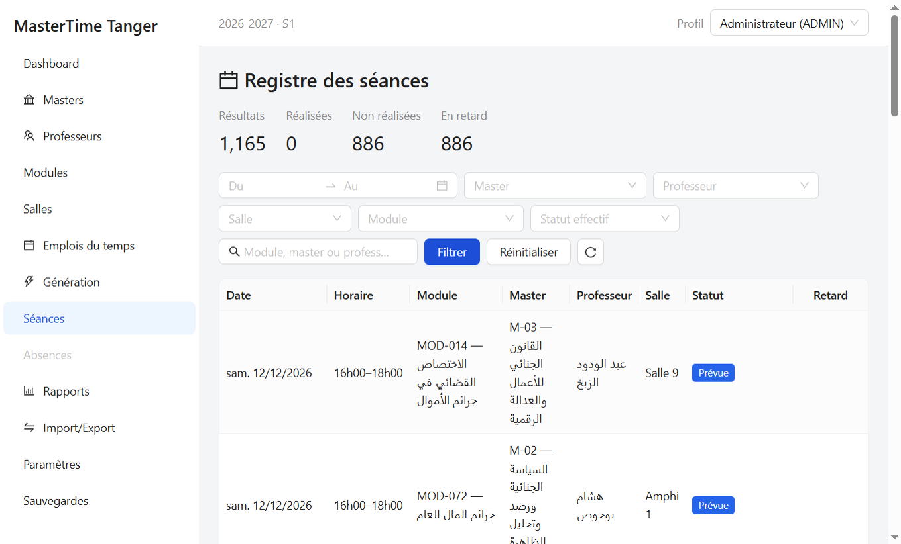
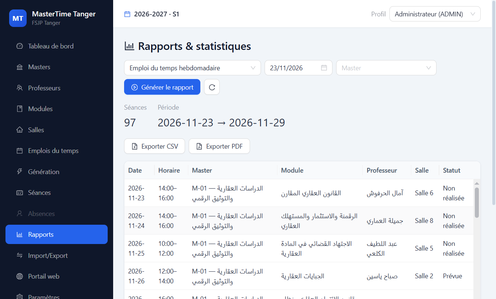
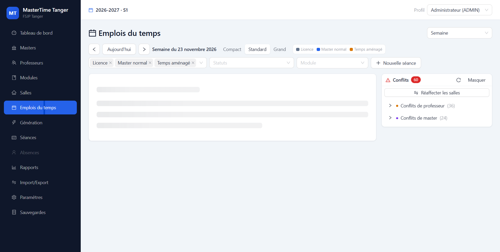
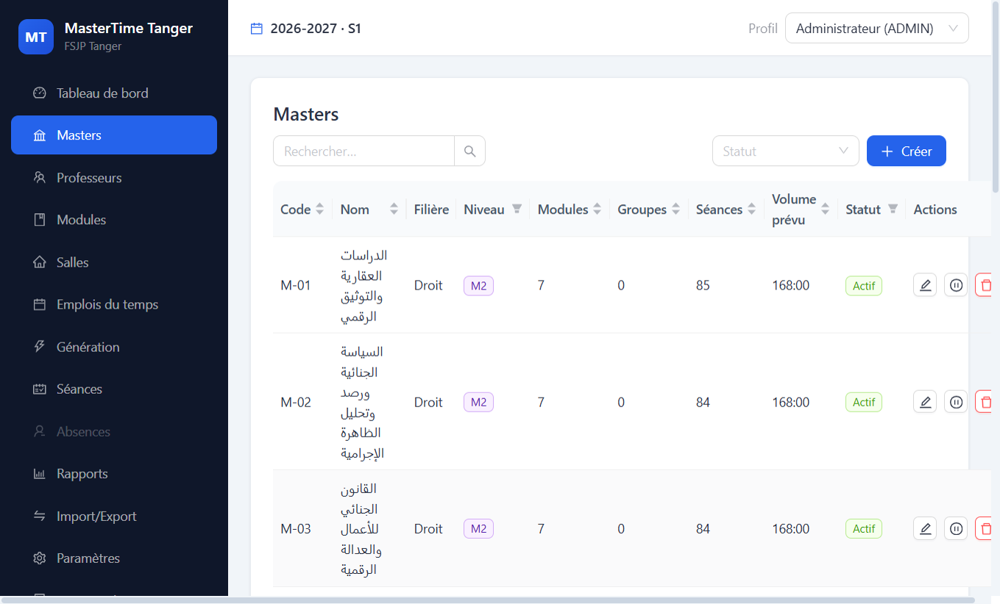
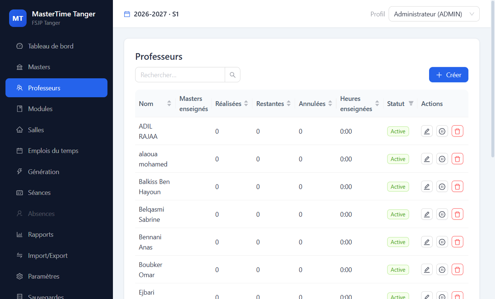
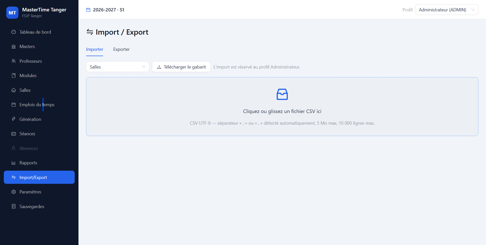
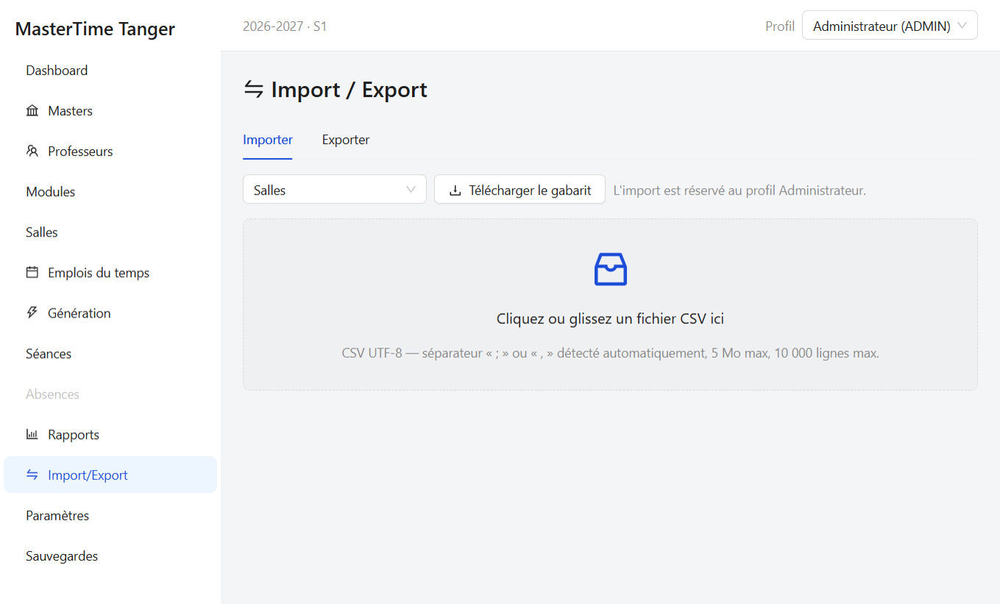
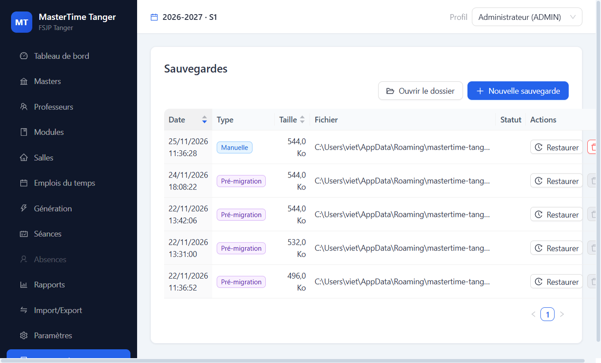

# MasterTime Tanger

**Gestion administrative des emplois du temps des Masters** —
Faculté des Sciences Juridiques et Politiques de Tanger
(Université Abdelmalek Essaâdi, campus Boukhalef).

Application de bureau **Windows, 100 % hors ligne** : aucune donnée ne
quitte le poste, aucun compte, aucun abonnement.


---

## Captures d'écran

| Emploi du temps — vraies données + panneau de conflits | Génération automatique |
|:---:|:---:|
|  |  |

| Registre des séances (retard « J+n ») | Rapports & statistiques |
|:---:|:---:|
|  |  |

<details>
<summary>Autres pages : tableau de bord, Masters, Professeurs,
Import/Export, Paramètres, Sauvegardes</summary>

| Tableau de bord | Masters |
|:---:|:---:|
|  |  |

| Professeurs | Import / Export |
|:---:|:---:|
|  |  |

| Paramètres | Sauvegardes |
|:---:|:---:|
|  |  |

</details>

---

## Fonctionnalités

**Emplois du temps**
- Vues Semaine / Mois / Année, filtrables par Master, Professeur, Salle
- **Clic sur une cellule vide → création de séance pré-remplie**
  (jour, heure, Master)
- Occupations Licence = contraintes permanentes tous semestres
- Panneau de conflits temps réel (salle, professeur, Master, groupe,
  occupation externe) — **les conflits bloquent l'écriture**, aucun
  contournement possible
- Édition manuelle complète : création, déplacement, statuts
  (prévue → réalisée / reportée / annulée), motif obligatoire tracé,
  historique conservé

**Génération automatique**
- Modes **Compléter** (séances manquantes uniquement) et
  **Régénérer** (remplace les prévues futures, jamais les passées)
- Contraintes dures : chevauchements, disponibilités et absences des
  professeurs, exceptions calendrier, capacité des salles, grille
  horaire — répartition régulière et charge max/jour en objectifs
- Aperçu obligatoire avant application : diff nouveau/remplacé +
  échecs expliqués avec suggestions
- **Modules « fixés »** : un module gelé n'est jamais déplacé par le
  moteur

**Suivi**
- Registre central : 10+ filtres combinés, retard « J+n » sur les
  séances non réalisées, « reste à effectuer » par module
- Absences des professeurs → séances impactées → **décision explicite**
  (remplaçant / report / annulation), résolution suivie
- Présences étudiants : compteurs ou registre nominatif
- **Feuille de présence imprimable** par séance (PDF) : tableau des
  étudiants, case « séance assurée par l'enseignant », signature du
  responsable — pour le circuit papier de la faculté

**Exploitation**
- 10 rapports (EDT hebdo, occupation salles, bilan heures
  prévues/effectuées, non réalisées, absences, avancement, conflits…)
  — exports **PDF** et **CSV compatible Excel**
- Import CSV (salles, professeurs, modules, Masters, étudiants) avec
  aperçu ligne à ligne et stratégie de conflit explicite — aucune
  écriture silencieuse
- **Masters « temps aménagé »** (payants) marqués — prépare le
  traitement avec le service économique
- Paramètres : créneaux horaires, exceptions calendrier (fériés,
  examens, fermetures, vacances)
- Sauvegardes horodatées avec rotation + **restauration atomique**
  (sauvegarde de sécurité automatique, redémarrage)
- Profils **Administrateur** / **Gestionnaire**, journal d'audit
  complet de toutes les écritures

**Portail web (P19)**
- **Site public** embarqué dans l'app (serveur `node:http` intégré,
  zéro dépendance) — joignable sur le réseau de la faculté via
  `http://<IP-du-PC>:8080`, ou déployable sur le serveur de la
  faculté (`server/index.mjs` autonome, même base SQLite)
- **Étudiants** : consultation libre de l'EDT par Master (semaine
  par jour), sans compte — fil d'**avis bilingue Français + Arabe**
  (style panneau d'affichage fsjest.ma) + logo FSJP officiel
- **Professeurs** : espace connecté (login + mot de passe gérés par
  l'admin) → déclarer une **annulation** ou proposer un **report** —
  le système propose les créneaux et salles réellement libres
- **Validation admin** : chaque demande arrive dans la console
  « Portail web » → **Approuver** applique la mutation (gardes-fous
  de conflits conservés) **et publie l'avis bilingue
  automatiquement** ; rejet avec note
- **Temps réel** : compteur de visiteurs et profs en ligne, boîte de
  **réclamations**, gestion des comptes profs, avis dépubliables
- Le serveur **redémarre automatiquement** avec l'app s'il était actif

## Installation (utilisateur)

1. Télécharger `Master Time Tanger Setup X.Y.Z.exe` depuis les
   [Releases](../../releases) (ou le produire via `npm run dist`).
2. Lancer le setup — **aucun droit administrateur requis**
   (installation par utilisateur), interface en français.
3. Premier lancement : la base locale se crée et les **données
   réelles FSJP** se chargent automatiquement (14 Masters, 133
   professeurs, 17 salles, ~1 160 séances, 168 occupations Licence).

Données stockées dans `%APPDATA%\MasterTime Tanger\` (base SQLite +
dossier `backups/`).

Documentation complète :
[`docs/GUIDE-UTILISATEUR.md`](docs/GUIDE-UTILISATEUR.md)

---

## Développement

Prérequis : **Node.js ≥ 22.13.0** (`node:sqlite` actif sans flag),
Windows pour l'installateur.

| Commande | Effet |
|---|---|
| `npm install` | Installe les dépendances (Electron ~150 Mo, attendu) |
| `npm run dev` | App en mode dev (electron-vite, HMR) |
| `npm test` | 358 tests Vitest (bases temporaires, règles métier) |
| `npm run typecheck` | TypeScript strict (renderer + main) |
| `npm run build` | Build production → `out/` |
| `npm run pack` | Packaging non compressé → `release/win-unpacked/` |
| `npm run dist` | Installateur NSIS → `release/` |

Stack : Electron 44 · React 19 · Ant Design 5 · TypeScript strict ·
SQLite natif `node:sqlite` (WAL, clés étrangères, migrations) ·
electron-vite · electron-builder.

```
electron/main/          processus principal — propriétaire unique de la DB
  db/                   connexion DatabaseSync + services métier + migrations/
  ipc/                  handlers IPC (contextBridge → window.api)
src/                    renderer React — client mince, aucun accès DB
shared/                 contrats de types main ↔ renderer
tests/                  Vitest — migrations, services, règles métier
docs/                   guide utilisateur + captures d'écran
scripts/make-icon.js    génère build/icon.png (Node pur)
electron-builder.yml    packaging NSIS (install par utilisateur, FR)
```

Architecture détaillée : `_bmad-output/planning-artifacts/`.
